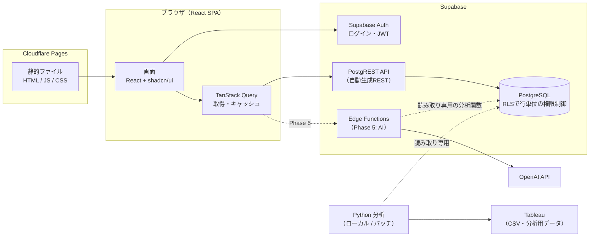
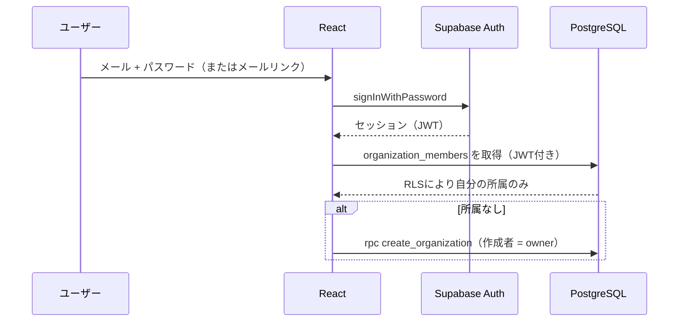

# アーキテクチャ

MJ Nexus は「常時稼働サーバーを持たない」構成です。静的なフロントエンド（Cloudflare Pages）と、マネージドなバックエンド（Supabase）だけで動きます。

## 全体像



| 層 | 技術 | 役割 | 採用理由 |
|---|---|---|---|
| UI | Vite / React / TypeScript (strict) | SPA | Next.js不要の静的配信で十分。Viteは起動・ビルドが速い |
| デザイン | Tailwind CSS v4 / shadcn/ui / Lucide | デザインシステム | shadcn/ui はコンポーネントのソースを自分のリポジトリに置くため、改変・学習しやすい |
| ルーティング | React Router | 画面遷移 | SPAの標準的な選択肢 |
| データ取得 | TanStack Query | 取得・キャッシュ・再試行 | Loading / Error 状態を一貫して扱える |
| グラフ | Recharts | 可視化（Phase 2以降） | React向けで宣言的に書ける |
| 認証 | Supabase Auth | ログイン | JWTがそのままDBのRLSに渡る |
| DB | Supabase PostgreSQL + RLS | データ・権限 | SQL（JOIN・CTE・ウィンドウ関数）で検証可能な集計ができる |
| サーバー処理 | Supabase Edge Functions | AI呼び出し（Phase 5） | APIキーをブラウザに出さずに済む。サーバー管理不要 |
| 分析 | Python (pandas / NumPy / SciPy / statsmodels) | 統計分析 | フロントから独立。まずローカル実行、将来API化 |
| 配信 | Cloudflare Pages | ホスティング | 静的配信・無料枠・ヘッダー設定（CSP）が可能 |

## 設計の原則

1. **数値はSQLかPythonが計算し、LLMは解釈のみ**（Phase 5）。LLMに生SQLを書かせない。
2. **権限はDBが守る**。フロントの画面ガードはUXのためで、本当の防御はRLS。
3. **「取れていない」と「0」を区別**する（`docs/database-design.md`）。
4. **架空の数値を表示しない**。データがない画面はEmpty Stateで次の行動を示す。
5. **未実装はComing Soonと明示**。ナビゲーション定義（`src/lib/nav.ts`）が唯一の情報源で、テストで検証している。

## ディレクトリ構成

```
mj-nexus/
├── src/                      フロントエンド
│   ├── app/                  ルーター・Provider・テーマ
│   ├── components/
│   │   ├── ui/               shadcn/ui 準拠の基本部品（Button, Card, …）
│   │   ├── layout/           AppShell・サイドバー・ヘッダー
│   │   └── states/           Empty / Loading / Error / Coming Soon
│   ├── features/             機能単位（auth, organization, 今後 social, marketing …）
│   ├── pages/                ページ（Overview, Settings, Coming Soon, 404）
│   ├── lib/                  env検証・Supabaseクライアント・CSV・指標・ナビ定義
│   ├── types/                DB型定義
│   └── test/                 テスト用ヘルパー
├── supabase/
│   ├── migrations/           スキーマ・RLS・ビュー（番号順に適用）
│   ├── tests/                素のPostgreSQLで動くRLS・制約テスト
│   └── config.toml           Supabase CLI ローカル設定（招待制）
├── shared/kpi-catalog.json   KPIの計算式の唯一の情報源（TS・Python・AIが参照）
├── src/demo/                 デモ表示用のサンプルデータ（VITE_DEMO_MODE=true のときだけ読み込む）
├── analytics/                Python 分析パッケージ（mj_analytics）+ pytest
├── scripts/test-db.sh        DBテストランナー
├── public/_headers           CSPなどのセキュリティヘッダー（Cloudflare Pages）
├── public/_redirects         SPAのルーティング用
├── .github/workflows/ci.yml  型チェック・Lint・テスト・ビルド
└── docs/                     設計ドキュメント
```

`features/` は機能ごとに UI・フック・型をまとめる場所です（`features/social/`、`features/content-planner/` …）。経営判断支援への拡張方針は [decision-support-design.md](decision-support-design.md) を参照してください。

## 開発フェーズ

| Phase | 内容 | 状態 |
|---|---|---|
| 1 | 共通基盤（Vite/React/TS・デザインシステム・レイアウト・Supabase接続・Auth・DBスキーマ・RLS・テスト環境） | **実装済み** |
| 2 | Social・Content Planner（投稿登録・指標入力・履歴・SNSダッシュボード・CSV）、施策・AI提案の受け皿 | **実装済み** |
| 3 | Marketing（問い合わせ・体験・ファネル・チャネル別） | 未着手 |
| 4 | Finance・Analytics（SQL集計ビュー・Python分析・KPI可視化・Tableau出力） | 未着手 |
| 5 | AI Insights（OpenAI・Tool Calling・安全な分析ツール・AI評価） | 未着手 |
| 6 | Students・Staff | 未着手 |
| 7 | Knowledge（RAG）・Learning | 未着手 |

DBスキーマは Phase 1 で全エンティティ分を先に用意しています（後から外部キーを追加するとデータ移行が必要になるため）。画面と集計ロジックは各フェーズで実装します。

## 認証フロー



- 新規登録は無効（招待制）。未成年の情報を扱うため、誰でもアカウントを作れる状態にしない。
- メールリンクは `shouldCreateUser: false` で、未登録メールからユーザーを作らない。

## Supabase 未接続モード

環境変数がない場合、アプリは「未接続モード」で起動し、画面の確認だけができます。上部に警告バナーを常に表示し、データの保存・ログインはできません。サンプルデータも表示しません。
