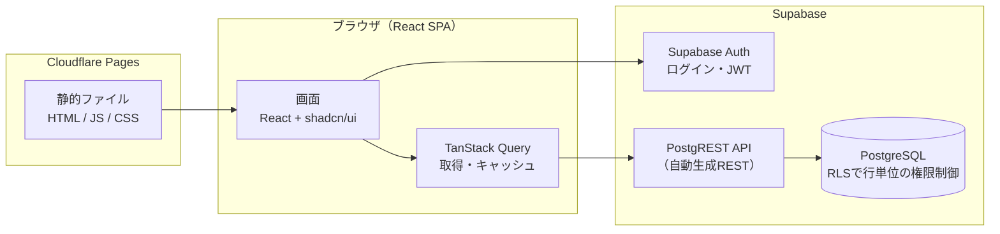
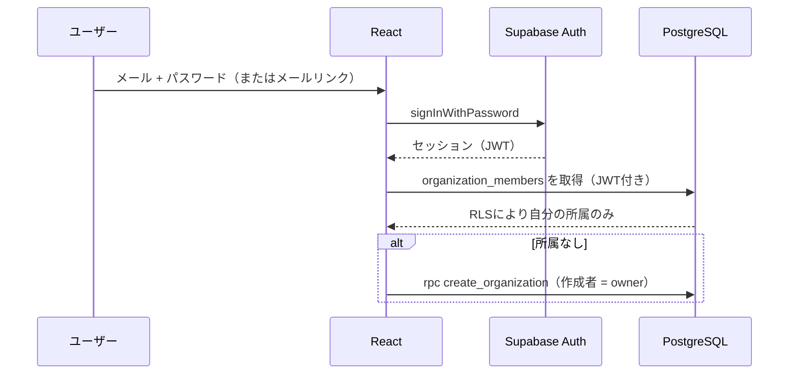

# アーキテクチャ

MJ Nexus は「常時稼働サーバーを持たない」構成です。静的なフロントエンド（Cloudflare Pages）と、マネージドなバックエンド（Supabase）だけで動きます。

**範囲**: 集客（問い合わせ → 体験授業 → 入会）の記録と、集客ファネル・集客費用の分析だけです。必要だと分かった機能だけをその都度追加します（[decision-log.md](decision-log.md) D-021）。

## 全体像



| 層 | 技術 | 役割 | 採用理由 |
|---|---|---|---|
| UI | Vite / React / TypeScript (strict) | SPA | Next.js不要の静的配信で十分。Viteは起動・ビルドが速い |
| デザイン | Tailwind CSS v4 / shadcn/ui / Lucide | デザインシステム | shadcn/ui はコンポーネントのソースを自分のリポジトリに置くため、改変・学習しやすい |
| ルーティング | React Router | 画面遷移 | SPAの標準的な選択肢 |
| データ取得 | TanStack Query | 取得・キャッシュ・再試行 | Loading / Error 状態を一貫して扱える |
| グラフ | Recharts | ファネルの横棒グラフ | React向けで宣言的に書ける |
| 認証 | Supabase Auth | ログイン | JWTがそのままDBのRLSに渡る |
| DB | Supabase PostgreSQL + RLS | データ・権限・集計 | SQL（CTE・集計関数）で検証可能な集計ができる |
| 配信 | Cloudflare Pages | ホスティング | 静的配信・無料枠・ヘッダー設定（CSP）が可能 |

## 設計の原則

1. **件数はSQLが数え、率は件数どうしを割るだけ**。分母が0や費用が未記録なら「計算不能」と表示し、0にしない。
2. **権限はDBが守る**。フロントの画面ガードはUXのためで、本当の防御はRLS。
3. **架空の数値を表示しない**。データがない画面はEmpty Stateで次の行動を示す。
4. **未実装の機能はメニューに出さない**。ナビゲーション定義（`src/lib/nav.ts`）が唯一の情報源で、テストで検証している。

## ディレクトリ構成

```
mj-nexus/
├── src/                      フロントエンド
│   ├── app/                  ルーター・Provider・テーマ
│   ├── components/           ui/（基本部品）・layout/・states/（Empty / Loading / Error）
│   ├── features/             auth / organization / marketing
│   ├── pages/                Settings・404
│   ├── lib/                  env検証・Supabaseクライアント・集客の計算（marketing.ts）・ナビ定義
│   ├── types/                DB型定義
│   ├── demo/                 デモ表示用のサンプルデータ（VITE_DEMO_MODE=true のときだけ読み込む）
│   └── test/                 テスト用ヘルパー
├── supabase/
│   ├── migrations/           スキーマ・RLS・ビュー・集計関数（番号順に適用）
│   ├── tests/                素のPostgreSQLで動くRLS・集計のテスト
│   └── config.toml           Supabase CLI ローカル設定（招待制）
├── shared/kpi-catalog.json   KPIの計算式の唯一の情報源（TS・Python・テストが参照）
├── analytics/                Python（KPIカタログの読み込み・データ量の確認）+ pytest
├── scripts/test-db.sh        DBテストランナー
├── public/_headers           CSPなどのセキュリティヘッダー（Cloudflare Pages）
├── .github/workflows/ci.yml  型チェック・Lint・テスト・ビルド
└── docs/                     設計ドキュメント
```

## 認証フロー



- 新規登録は無効（招待制）。未成年の情報を扱うため、誰でもアカウントを作れる状態にしない。
- メールリンクは `shouldCreateUser: false` で、未登録メールからユーザーを作らない。

## Supabase 未接続モード

環境変数がない場合、アプリは「未接続モード」で起動し、画面の確認だけができます。上部に警告バナーを常に表示し、データの保存・ログインはできません。サンプルデータも表示しません。
