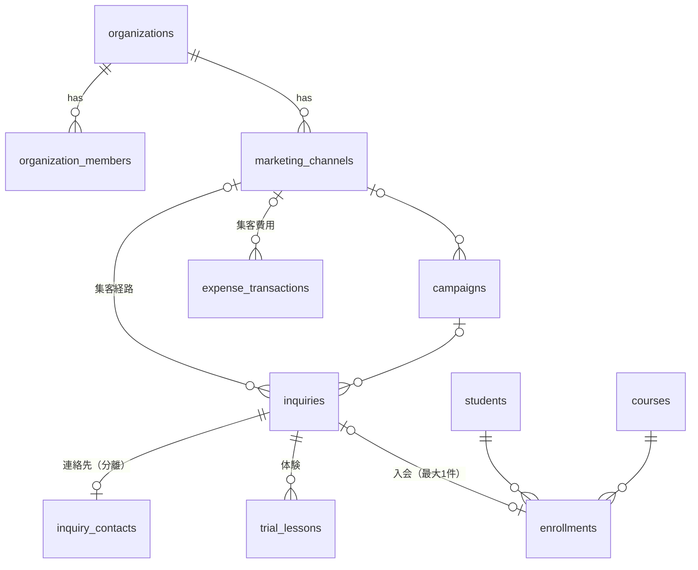

# データベース設計

定義元: `supabase/migrations/`。この文書は「なぜそう設計したか」を説明します。

## 用語

- **主キー（PK）**: 行を一意に識別する列。全テーブルで `uuid` を使用（推測されにくく、複数環境で衝突しない）。
- **外部キー（FK）**: 別テーブルの行を参照する列。存在しない行への参照をDBが拒否する。
- **ユニーク制約**: 同じ値の重複登録をDBが拒否する。二重計上の防止に使う。
- **RLS（Row Level Security）**: 行ごとのアクセス権限をDBが強制する仕組み。
- **ビュー**: 保存されたSELECT文。テーブルのように参照できる。

## ER図

## テーブル・ビュー・関数

| 種類 | 名前 | 概要 |
|---|---|---|
| 共通 | `organizations` | スクール（組織）。全業務データはこれに属する |
| 共通 | `profiles` | ユーザーの表示名。認証情報本体は `auth.users`（Supabase管理） |
| 共通 | `organization_members` | 所属とロール（owner / admin / editor / viewer） |
| 集客 | `marketing_channels` | 集客チャネル（`code` は UTM の utm_source に対応） |
| 集客 | `campaigns` | キャンペーン（`utm_campaign` で識別） |
| 集客 | `inquiries` | 問い合わせ（個人情報を持たない）。きっかけの確度 `attribution` と UTM を保持 |
| 集客 | `inquiry_contacts` | 問い合わせ者の連絡先（admin以上のみ） |
| 集客 | `trial_lessons` | 体験授業の申込・参加・欠席・キャンセル |
| 入会 | `courses` / `students` / `enrollments` | コース・生徒（呼び名と学年のみ）・契約 |
| 費用 | `expense_transactions` | 費用の台帳 |
| 費用 | `marketing_costs`（ビュー） | 費用のうち集客費用（広告費・キャンペーン費・制作外注費） |
| 集客 | `inquiry_pipeline`（ビュー） | 問い合わせ × チャネル名・体験の件数・入会日・進捗 |
| 集客 | `marketing_funnel()`（関数） | 問い合わせ月コホートのファネル件数・費用 |
| 入会 | `record_enrollment()`（関数） | 生徒と契約を1トランザクションで作成 |

## 設計判断

### 1. きっかけは確度と一緒に記録する

`inquiries.attribution`（`tracked_link` / `self_reported` / `staff_inferred` / `unknown`）で、きっかけがどの程度確かかを残します。自己申告の「Instagramで見た」と、UTM付きリンク経由とを同列に扱わないためです。画面では、流入URLのUTMを反映した場合だけ「追跡リンク」を選べます。

### 2. 二重計上の防止

| リスク | 対策 |
|---|---|
| 同じ問い合わせから2回入会としてカウント | `enrollments.inquiry_id` の部分ユニークインデックス |
| 体験の振替で問い合わせが重複カウント | 体験は複数行を許容し、ファネルでは問い合わせごとに `exists` で0/1にして数える |
| 費用を2か所に入力 | 費用は `expense_transactions` に一本化し、`marketing_costs` はビュー |

### 3. 組織間のデータ混在を防ぐ複合外部キー

子テーブルは `(organization_id, 親id)` の組で親を参照します。これにより「組織Bの体験が組織Aの問い合わせにぶら下がる」ことがDBレベルで不可能になります（テスト: `cross-org inquiry reference`）。

### 4. 個人情報の最小化（未成年への配慮）

- 生徒は **呼び名と学年のみ**。氏名・生年月日・住所・学校名は持たない。
- 問い合わせ者の連絡先は別テーブル（`inquiry_contacts`）に分離し、**admin以上だけ** が読める。
- `inquiries.notes` に個人情報を書かない運用とする（画面で注意喚起）。

### 5. 金額は円の整数

`bigint` で保持し、浮動小数点の丸め誤差を避けます。

### 6. 集客ファネル

- `marketing_funnel(p_org, p_from, p_to, p_group)`: 期間内（日本時間の日付）に問い合わせた人を、その後の体験申込・参加・入会・失注で数える。`p_group` は total / channel / attribution。
- 権限: editor 以上（閲覧者は入会を読めないため、0件と誤表示しないよう拒否）。費用は admin 以上のみ。費用が「権限なし」か「未記録」かは `cost_visible` で区別する。
- `inquiry_pipeline` は閲覧者に `stage` と `enrolled_on` を NULL で返す（`enrollment_visible = false`）。

## RLS（権限）

| データ | viewer | editor | admin | owner |
|---|---|---|---|---|
| チャネル・キャンペーン・問い合わせ・体験 | 閲覧 | 編集 | 編集 | 編集 |
| コース | 閲覧 | 閲覧 | 編集 | 編集 |
| 生徒・契約 | — | 閲覧 | 編集 | 編集 |
| 連絡先・費用 | — | — | 編集 | 編集 |
| メンバー管理 | 閲覧 | 閲覧 | 閲覧 | 編集 |

- 判定関数 `private.has_role(org, min_role)` は `security definer` + `search_path=''` で、APIに公開されない `private` スキーマに置いています。
- 未ログイン（`anon`）はすべてのテーブルへのアクセス権を取り消し済み。
- ビューは `security_invoker = true` で、呼び出したユーザーのRLSが適用されます。
- 最後のownerは削除・降格できません（トリガー）。

## 初期データ

- DBは空の状態から始めます。**サンプルの実績データは投入しません。**
- `create_organization()` は集客チャネル5件を登録します。これは「設定値」であり、実績ではありません。

## テスト

`scripts/test-db.sh` が一時DBを作り、Supabase互換の最小シム（`auth.uid()`・ロール）→ マイグレーション → `supabase/tests/` を実行します。Dockerなしで動き、CIでも実行します。

- `10_rls_and_constraints.sql`: 組織・権限・制約・二重計上の防止
- `20_marketing_funnel.sql`: 日本時間の期間境界、振替の重複、費用の区分と期間、権限、入会の二重登録・日付の逆転
