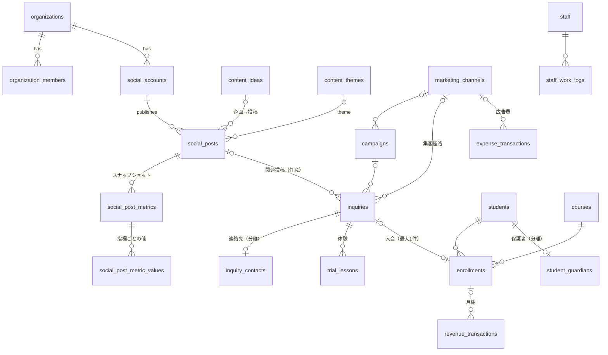

# データベース設計

定義元: `supabase/migrations/`。この文書は「なぜそう設計したか」を説明します。

## 用語

- **主キー（PK）**: 行を一意に識別する列。全テーブルで `uuid` を使用（推測されにくく、複数環境で衝突しない）。
- **外部キー（FK）**: 別テーブルの行を参照する列。存在しない行への参照をDBが拒否する。
- **ユニーク制約**: 同じ値の重複登録をDBが拒否する。二重計上の防止に使う。
- **RLS（Row Level Security）**: 行ごとのアクセス権限をDBが強制する仕組み。
- **ビュー**: 保存されたSELECT文。テーブルのように参照できる。

## ER図（主要部分）



## テーブル一覧

| モジュール | テーブル | 概要 |
|---|---|---|
| 共通 | `organizations` | スクール（組織）。全業務データはこれに属する |
| 共通 | `profiles` | ユーザーの表示名。認証情報本体は `auth.users`（Supabase管理） |
| 共通 | `organization_members` | 所属とロール（owner / admin / editor / viewer） |
| Social | `social_accounts` | Instagram・TikTokのアカウント |
| Social | `content_themes` | 投稿テーマのマスタ（組織ごとに編集可） |
| Social | `content_ideas` | 投稿企画（Idea → … → Analyzed）。仮説・振り返りを保持 |
| Social | `social_posts` | 投稿。企画・テーマ・形式・フック・CTA・公開日時・制作時間 |
| Social | `social_post_metrics` | 実績の記録時点（スナップショット） |
| Social | `social_post_metric_values` | スナップショット × 指標の値と状態 |
| Marketing | `marketing_channels` | 集客チャネル（`code` はUTM sourceに対応） |
| Marketing | `campaigns` | キャンペーン（`utm_campaign` で識別） |
| Marketing | `inquiries` | 問い合わせ（個人情報を持たない） |
| Marketing | `inquiry_contacts` | 問い合わせ者の連絡先（admin以上のみ） |
| Marketing | `trial_lessons` | 体験授業の申込・参加・キャンセル |
| Students | `courses` / `students` / `student_guardians` / `enrollments` | コース・生徒・保護者連絡先・契約 |
| Staff | `staff` / `staff_work_logs` | 講師・稼働記録 |
| Finance | `revenue_transactions` / `expense_transactions` | 売上・費用（費用は唯一の台帳） |
| Finance | `marketing_costs`（ビュー） | 費用台帳のうちマーケティング費用 |
| AI | `ai_analysis_logs` | AIへの質問・呼んだツール・構造化回答（監査用、更新・削除不可） |
| AI | `ai_recommendations` | AIの提案（課題・仮説・施策・提案時点の根拠データ）。作成者と admin 以上のみ閲覧（Phase 2で作成） |
| 意思決定 | `initiatives` / `initiative_events` | 施策と実施記録・ベースライン・評価結果（Phase 2で作成） |
| Social | `social_post_snapshot_kpis`（ビュー） | 記録時点ごとに指標を横に並べ、率を計算（Phase 2） |
| Social | `social_post_kpis`（ビュー） | 投稿 × 最新記録時点のSNS指標。未記録の投稿も含む（Phase 2） |

## 設計判断

### 1. SNS実績は「履歴」として縦持ちで保存する

実績は時間とともに増えるため、上書きせずに **記録した時点ごと** に保存します。

```
social_post_metrics         … 「投稿Xの、2026-11-02 19:00 時点の記録」
social_post_metric_values   … 「その記録の views は 120（実測）」「link_clicks は未取得」
```

- `unique (post_id, recorded_at)` で同じ時点の二重登録を防ぐ。
- 公開24時間後・72時間後・7日後の比較は、`recorded_at - published_at` で計算する（ビューの `hours_since_publish`）。
- **縦持ち（long format）**: 1行 = 1指標。プラットフォームごとに取れる指標が違っても、列を増やさずに済む。Tableau やpandasでも扱いやすい。

### 2. 未記録・未取得・非対応・実測0を区別する

| 状態 | DBでの表現 | 例 |
|---|---|---|
| 実測（0を含む） | `status='measured'`, `value=数値` | いいね0件 |
| 未取得 | `status='not_collected'`, `value=NULL` | 確認し忘れた |
| 非対応 | `status='unsupported'`, `value=NULL` | プラットフォームが提供しない指標 |
| 未記録 | 行が存在しない | まだ入力していない |

CHECK制約 `(status = 'measured') = (value is not null)` により、「未取得なのに0が入っている」状態をDBが拒否します。集計時は実測の行だけを使い、比率の分母が0や欠損なら「計算不能」として扱います（`src/lib/metrics.ts` / `analytics/mj_analytics/metrics.py`）。

### 3. 累積値を合計しない

同じ投稿の24時間後と72時間後の再生数を足すと二重計上になります。ビュー `social_post_latest_metric_values` は、ウィンドウ関数 `row_number() over (partition by post_id, metric order by recorded_at desc)` で投稿 × 指標ごとに最新の1行だけを返します。Python側の `latest_snapshot_values()` も同じ規則で、テストで両方の結果を確認しています。

### 3-2. 率は「同じ記録時点」の値どうしで計算する（Phase 2）

`social_post_kpis` は、投稿ごとに **最新のスナップショット1件** の値で率を計算します。指標ごとに最新値を取る（`social_post_latest_metric_values`）と、「24時間後のいいね ÷ 7日後のリーチ」のように時点のずれた値を割ってしまうためです。実績の保存は関数 `record_post_metrics()` で行い、スナップショットと指標値を1トランザクションで保存します（1つでも不正な値があれば全体を保存しない）。

### 4. ファネルの追跡: 識別できるイベントとSNS集計値を分ける

- SNS側（閲覧・プロフィールアクセス・リンククリック）は **集計値** で、個人を追跡できません。
- 問い合わせ以降（`inquiries` → `trial_lessons` → `enrollments`）は **個別のイベント** として記録します。
- 問い合わせと投稿の関係は `inquiries.social_post_id` と `attribution`（`tracked_link` / `self_reported` / `staff_inferred` / `unknown`）で記録し、**どの程度確かな紐づけか** を残します。自己申告の「Instagramで見た」と、UTM付きリンク経由とを同列に扱わないためです。
- UTM列（`utm_source` など）は将来の流入識別のために先に用意しています。

### 5. 二重計上・二重集計の防止

| リスク | 対策 |
|---|---|
| 同じ問い合わせから2回入会としてカウント | `enrollments.inquiry_id` の部分ユニークインデックス |
| 同じ契約の同じ月の月謝を2回計上 | `revenue_tuition_once_per_month`（`enrollment_id, billing_month`） |
| 広告費を「マーケ費用」と「費用」の両方に入力 | 費用は `expense_transactions` に一本化し、`marketing_costs` はビュー |
| 人件費を稼働記録と費用の両方から計上 | 損益は `expense_transactions(category='labor')` を正とし、稼働記録×時給は「見込み」としてのみ使う |
| 同じ時点の実績を2回入力 | `unique (post_id, recorded_at)` |
| 体験の振替で問い合わせが重複カウント | 体験は複数行を許容し、ファネルでは `count(distinct inquiry_id)` で数える（Phase 3） |

### 6. 組織間のデータ混在を防ぐ複合外部キー

子テーブルは `(organization_id, 親id)` の組で親を参照します。これにより「組織Bの投稿が組織Aのアカウントにぶら下がる」ことがDBレベルで不可能になります（テスト: `cross-org account reference`）。

### 7. 個人情報の最小化（未成年への配慮）

- 生徒は **呼び名と学年のみ**。氏名・生年月日・住所・学校名は持たない。
- 保護者・問い合わせ者の連絡先は別テーブル（`inquiry_contacts` / `student_guardians`）に分離し、**admin以上だけ** が読める。
- `inquiries.notes` などの自由記述に個人情報を書かない運用とする（Phase 3のUIで注意喚起）。
- AIに渡すデータは集計結果のみ（Phase 5）。`ai_analysis_logs` にも個人情報を含めない。

### 8. 金額は円の整数

`bigint` で保持し、浮動小数点の丸め誤差を避けます。返金は売上のマイナス金額で表します。

## RLS（権限）

| データ | viewer | editor | admin | owner |
|---|---|---|---|---|
| SNS・企画・集客（問い合わせ・体験） | 閲覧 | 編集 | 編集 | 編集 |
| コース | 閲覧 | 閲覧 | 編集 | 編集 |
| 生徒・契約 | — | 閲覧 | 編集 | 編集 |
| 連絡先・財務・講師・稼働 | — | — | 編集 | 編集 |
| メンバー管理 | 閲覧 | 閲覧 | 閲覧 | 編集 |
| AIログ | 自分の分 | 自分の分 | 全員分 | 全員分 |

- 判定関数 `private.has_role(org, min_role)` は `security definer` + `search_path=''` で、APIに公開されない `private` スキーマに置いています。
- 未ログイン（`anon`）はすべてのテーブルへのアクセス権を取り消し済み。
- ビューは `security_invoker = true` で、呼び出したユーザーのRLSが適用されます。
- 最後のownerは削除・降格できません（トリガー）。

## 初期データ

- DBは空の状態から始めます。**サンプルの実績データは投入しません。**
- `create_organization()` は投稿テーマ6件と集客チャネル5件を登録します。これは「設定値」であり、実績ではありません。
- 開発用サンプルデータが必要になった場合は、本番と完全に分離したローカル環境専用の `supabase/seed/dev_sample.sql` として作り、全レコードに「サンプル」と分かる名前を付けます（Phase 2で検討）。

## テスト

`scripts/test-db.sh` が一時DBを作り、Supabase互換の最小シム（`auth.uid()`・ロール）→ マイグレーション → `supabase/tests/10_rls_and_constraints.sql` を実行します。Dockerなしで動き、CIでも実行します。
