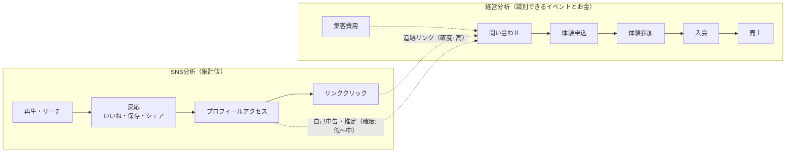
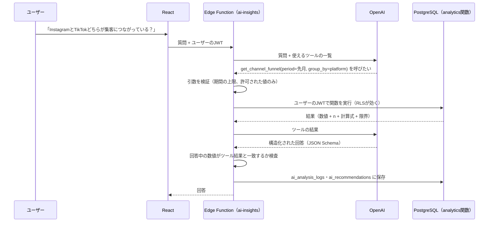
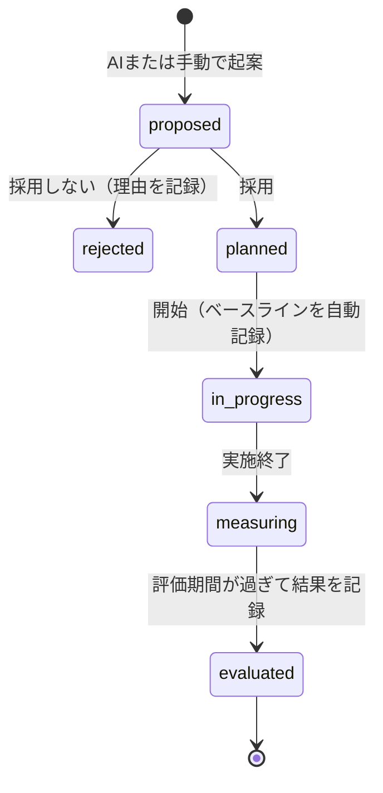

# 経営判断支援の設計

MJ Nexus を「SNS運用ツール」から「経営データをAIで分析し、意思決定を支援するシステム」へ広げるための設計です。Phase 1 のスキーマとコードを壊さずに、追加だけで実現できる形にしています。

> **状態**: 設計。Phase 2 では、この設計のうちDBの受け皿（追跡コード・施策・AI提案のテーブル）と、SNS分析の部分を実装します。経営KPIの集計は Phase 3〜4、AIは Phase 5 で実装します。実績データがまだないため、**どのKPIも現時点では未検証** です。

---

## 1. 既存コードの調査結果

| 項目 | 現状（Phase 1） | 拡張に使えるか |
|---|---|---|
| 投稿と問い合わせの紐づけ | `inquiries.social_post_id` と `attribution`（紐づけの確度）がある | そのまま使える。追跡リンク用のコードが足りない |
| 問い合わせ → 体験 → 入会 | `inquiries` → `trial_lessons` → `enrollments`（1問い合わせ1入会の制約あり） | そのまま使える |
| 売上 | `revenue_transactions.enrollment_id` で契約に紐づく | 入会経路別の売上（LTV）を計算できる |
| 集客費用 | `expense_transactions` に channel / campaign があり、`marketing_costs` ビューで参照 | チャネル別のCPA・CACを計算できる |
| AIの記録 | `ai_analysis_logs`（質問・呼び出したツール・回答） | 提案そのものと、その後の結果を記録する場所がない |
| 指標の定義 | `docs/kpi-definitions.md` と `safeRate`（TS）・`safe_rate`（Python） | 定義をコードから参照できる形（KPIカタログ）にする |
| 権限 | 組織単位のRLS、4ロール | 新しいテーブルも同じ仕組みで保護できる |

**結論**: ファネルとお金の流れは Phase 1 のスキーマですでにつながっています。足りないのは次の3つです。

1. 追跡リンクで投稿を識別する仕組み（`social_posts.tracking_code`）
2. AIの提案と、それを実行した施策の記録（`ai_recommendations`・`initiatives`・`initiative_events`）
3. KPIの計算式をコードとして一か所にまとめ、結果に「根拠」を付けて返す仕組み（KPIカタログ + 分析関数）

---

## 2. SNS分析と経営分析の区別

この2つは **問いもデータも違う** ので、画面・コード・AIツールのすべてで分けて扱います。

| | SNS分析 | 経営分析・意思決定支援 |
|---|---|---|
| 問い | どの投稿がよく見られ、反応されたか | 何が問い合わせ・入会・売上・利益につながったか。次に何をすべきか |
| 主なデータ | SNSの集計値（再生・リーチ・いいね・保存など） | 個別に識別できるイベント（問い合わせ・体験・入会）とお金（売上・費用） |
| データの性質 | プラットフォームが出す集計値。個人は追えない | 1件ずつ記録した事実 |
| 代表的な指標 | エンゲージメント率、保存率、プロフィール遷移率 | 入会転換率、CPA、CAC、ROAS、月次利益、利益率 |
| 置き場所 | `features/social`、ビュー `social_post_kpis` | `features/marketing`・`features/analytics`、`analytics` スキーマの関数 |
| 画面の表示 | 「SNS指標」ラベル | 「経営指標」ラベル |
| 言えること | 「この投稿は反応が多かった」 | 「このチャネルの問い合わせは入会率が高い（n件、確度◯）」 |

**2つをつなぐ橋は `inquiries` だけ** です。SNSの数字（再生数など）から入会数を推定することはしません。投稿が入会に貢献したと言えるのは、問い合わせがその投稿に紐づいている場合だけで、紐づけの確度（`attribution`）を必ず表示します。



---

## 3. 投稿実績を問い合わせ・入会・売上・費用と関連付ける（要件1）

### 紐づけの経路と確度

| 方法 | `attribution` | 確度 | 仕組み |
|---|---|---|---|
| 追跡リンク | `tracked_link` | 高 | プロフィールリンク等に `?utm_source=instagram&utm_content=<tracking_code>` を付け、問い合わせフォームが値を保存 |
| 本人の回答 | `self_reported` | 中 | 問い合わせ時の「何で知りましたか」「どの動画を見ましたか」 |
| スタッフの推定 | `staff_inferred` | 低 | 会話内容などから推定 |
| 不明 | `unknown` | — | 紐づけない |

- **Phase 2 で追加**: `social_posts.tracking_code`（組織内で一意の短いコード）。投稿ごとに追跡リンクを作れるようにする。
- 問い合わせフォーム（Phase 3）で UTM を受け取り、`tracking_code` から `social_post_id` を自動設定する。

### つながる数字

```
投稿 ──(attribution付き)── 問い合わせ ── 体験 ── 入会 ── 売上（月謝の累計）
 │                              │
 └ 制作時間                      └ チャネル・キャンペーン ── 集客費用
```

これで次の分析ができます（すべて確度別に集計）。

- 投稿テーマ別の問い合わせ数・入会数
- チャネル別の CPA（問い合わせ獲得単価）・CAC（顧客獲得単価）
- 入会経路別の売上（入会後に発生した売上の合計）
- ROAS（費用に対する売上の倍率）

**投稿ごとのCAC・ROASは計算しない** ことにします。オーガニック投稿には直接の費用がなく、問い合わせ数も少ないため、投稿単位の数字は誤解を生みやすいからです。費用対効果はチャネル・キャンペーン単位で見ます。

---

## 4. 経営KPIをSQL・Pythonで計算する（要件2）

### 役割分担

| 層 | 担当 | 例 |
|---|---|---|
| SQLビュー・関数（`analytics` スキーマ） | 数える・足す・割る。正確さを保証する | 月次ファネル、チャネル別CPA、月次損益 |
| Python（`mj_analytics`） | 統計。不確実性を出す | 率の信頼区間、2群比較の検定、施策前後の比較 |
| TypeScript | 表示だけ。計算し直さない | グラフ、表 |

### KPIカタログ（計算式の唯一の情報源）

`shared/kpi-catalog.json` に、各KPIの ID・名前・区分（SNS / 経営）・計算式・分母・単位・版を定義します。

- 画面はここから計算式と分母を表示する
- SQL・Pythonの結果には `kpi_id` と `formula_version` を付ける
- AIの回答にも同じ `kpi_id` を含め、計算式を表示できるようにする
- 計算式を変えたら版を上げる（過去の提案がどの式に基づいていたか分かる）

### 結果の形（すべての分析関数で共通）

```json
{
  "kpi_id": "conversion_inquiry_to_enrollment",
  "formula_version": 1,
  "formula": "入会した問い合わせ数 ÷ 問い合わせ数",
  "period": { "from": "2026-12-01", "to": "2026-12-31", "timezone": "Asia/Tokyo" },
  "value": 0.25,
  "numerator": 3,
  "denominator": 12,
  "n": 12,
  "verification": "insufficient_sample",
  "limitations": ["問い合わせが12件のため、率の幅が大きい（95%信頼区間 9〜53%）", "直近30日の問い合わせはまだ入会判断前"]
}
```

`verification` の値:

| 値 | 意味 | 画面の表示 |
|---|---|---|
| `no_data` | 実績データがない | **未検証**（データなし） |
| `insufficient_sample` | データはあるが件数が少ない | 参考値（n件） |
| `computed` | 十分な件数で計算できた | 通常表示 + n |

サンプル数の基準は `docs/analysis-methods.md`（Phase 1 で `sample_size_level` として実装済み）を使います。

### 主な経営KPI（Phase 3〜4で実装）

| KPI | 計算 | 実装 |
|---|---|---|
| 問い合わせ→入会転換率 | 問い合わせ月コホートで、入会した数 ÷ 問い合わせ数 | SQL（CTE + `count(distinct)`）+ Python（信頼区間） |
| チャネル別CPA・CAC | `marketing_costs` ÷ 問い合わせ数・入会数（期間とチャネルを揃える） | SQL |
| ROAS | 入会経路別の売上 ÷ 集客費用 | SQL |
| 月次売上・費用・利益・利益率 | `revenue_transactions` と `expense_transactions` の月合計 | SQL |
| 問い合わせ→入会日数 | 中央値 | SQL（`percentile_cont`） |
| 施策前後の比較 | 同じ長さの前後期間でKPIを比較 | Python |

---

## 5. AIが分析ツールを選んで実データを分析する（要件3）

### 仕組み



### 安全のための決まり

- LLMは **生のSQLを書かない**。呼べるのは下記の読み取り専用関数だけ。
- 関数はユーザーのJWTで実行し、RLSが効く（service_roleを使わない）。
- 引数は zod で検証（期間は最大24か月、列挙値のみ）。
- AIに渡すのは集計結果だけ。個人情報（連絡先、生徒の呼び名）は渡さない。

### ツール一覧（予定）

| ツール | 区分 | 返すもの |
|---|---|---|
| `get_data_coverage` | 共通 | 期間・件数・欠損（まず最初に呼ぶ） |
| `get_social_performance` | SNS | 投稿・テーマ・形式・時間帯別のSNS指標 |
| `get_funnel` | 経営 | 問い合わせ→体験→入会の件数と率（確度別） |
| `get_channel_economics` | 経営 | チャネル・キャンペーン別の費用・CPA・CAC・ROAS |
| `get_theme_to_inquiry` | 橋渡し | 投稿テーマ別の問い合わせ・入会（紐づけ確度別） |
| `get_monthly_pnl` | 経営 | 月次の売上・費用・利益・利益率 |
| `compare_periods` | 経営 | 2期間のKPI比較（Python、信頼区間付き） |
| `get_initiatives` | 振り返り | 過去の施策と、その結果の評価 |

---

## 6. AIが経営課題・改善仮説・次の施策を提案する（要件4）

AIの回答は JSON Schema で形を固定し、次の項目を必須にします。

| 項目 | 内容 | 事実か仮説か |
|---|---|---|
| 結論 | 質問への短い答え | 解釈 |
| 対象期間 | 日付の範囲 | 事実 |
| 根拠データ | 使ったツール結果の参照（`kpi_id`・値・n） | 事実 |
| 分析結果 | 数値の説明 | 事実 |
| 経営課題 | 「問い合わせは来るが体験参加率が低い」など | 解釈 |
| 改善仮説 | 「体験日程の選択肢が少ないことが原因かもしれない」 | **仮説** |
| 推奨施策 | 具体的な行動、対象KPI、期待する変化、評価期間 | 提案 |
| 不確実性・限界 | n、欠損、相関と因果の区別、追跡できない部分 | 事実 |

推奨施策は `ai_recommendations` に1件ずつ保存します。

---

## 7. 提案の根拠を表示する（要件5）

`ai_recommendations.evidence`（JSON）に、提案を作ったときのツール結果を **そのまま保存** します。あとでデータが増えても、「提案した時点で何を見ていたか」が分かります。

画面（AI Insights・施策詳細）では次を表示します。

- 使ったKPIと **計算式**（KPIカタログから）、分母
- **分析期間** とタイムゾーン
- 件数（n）と `verification`（データなし＝**未検証**、件数不足＝参考値）
- 欠損の状況（未取得・非対応の割合）
- 紐づけの確度（追跡リンク / 自己申告 / 推定）
- 限界（因果ではなく相関であること、など）

---

## 8. 施策の実施と結果を記録・検証する（要件6）

### 流れ



### テーブル（Phase 2 で受け皿を作成、画面は Phase 5）

- **`initiatives`**（施策）: タイトル、仮説、元になったAI提案、対象KPI（`kpi_id`）、ベースライン値と期間、目標値、開始日・終了日、評価期間、状態、結果の値、評価（改善 / 変化なし / 悪化 / 判定不能）、振り返り。
- **`initiative_events`**（実施記録）: 「投稿を3本追加した」「体験日程を週2回に増やした」など、実際にやったことを日付付きで記録。
- `content_ideas.initiative_id`・`campaigns.initiative_id`: 施策で作った企画やキャンペーンを紐づける。

### 検証の考え方

- 開始時に対象KPIの **ベースライン**（直前の同じ長さの期間の値）を自動で保存する。
- 評価期間が終わったら、同じ計算式（`formula_version` を揃える）で結果を計算する。
- 評価は「改善した」と断定せず、件数と信頼区間を見て `inconclusive`（判定不能）も使う。
- 前後比較は因果の証明ではないことを表示する（季節・他の施策の影響）。
- 結果は次回のAI分析で `get_initiatives` から参照され、「前回の施策ではこうだった」を踏まえた提案になる。

---

## 9. フェーズへの割り当て

| Phase | この設計から実装するもの |
|---|---|
| 2 | `tracking_code`、`initiatives`・`initiative_events`・`ai_recommendations` のテーブルとRLS、KPIカタログ（SNS指標）、`social_post_kpis` ビュー、SNSダッシュボードの「SNS指標」ラベルと未検証表示 |
| 3 | 問い合わせ・体験・入会の画面、UTMの受け取り、`analytics.funnel`・`channel_economics` 関数、紐づけ確度別の集計 |
| 4 | 売上・費用の画面、`analytics.monthly_pnl`・ROAS、Pythonの信頼区間・前後比較、Tableau出力 |
| 5 | Edge Function、ツール、構造化回答、`ai_recommendations` の保存と表示、施策の画面、AI評価テスト |

## 10. 既存機能への影響

- 既存テーブルへの変更は **列の追加のみ**（`social_posts.tracking_code`、`content_ideas.initiative_id`、`campaigns.initiative_id`）。すべて NULL 可で、既存の行や画面に影響しない。
- 新しいテーブルは Phase 1 と同じRLSの仕組み（`private.has_role`）で保護する。
- Phase 1 のDBテストはそのまま通ることを確認し、新しいテーブルのテストを追加する。
